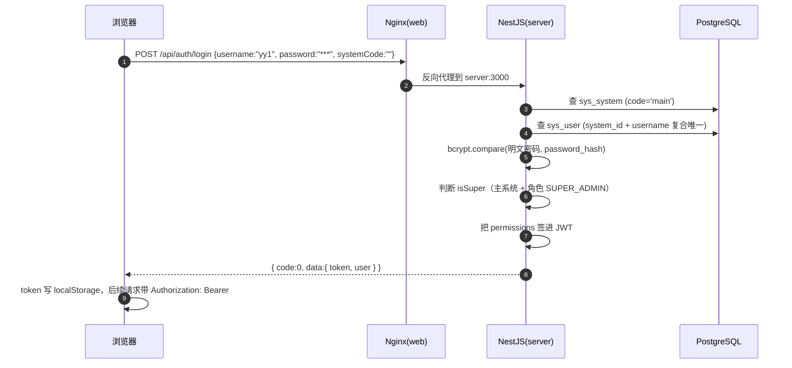
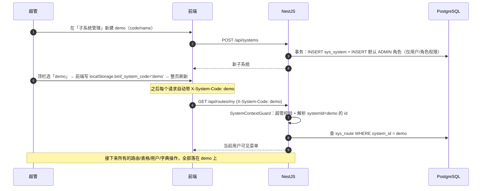
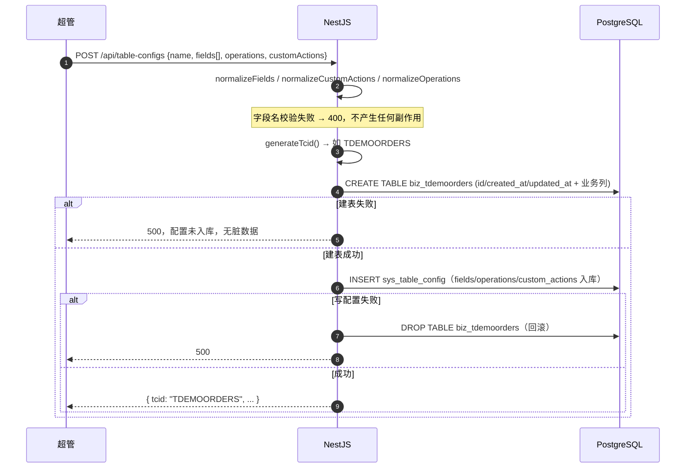
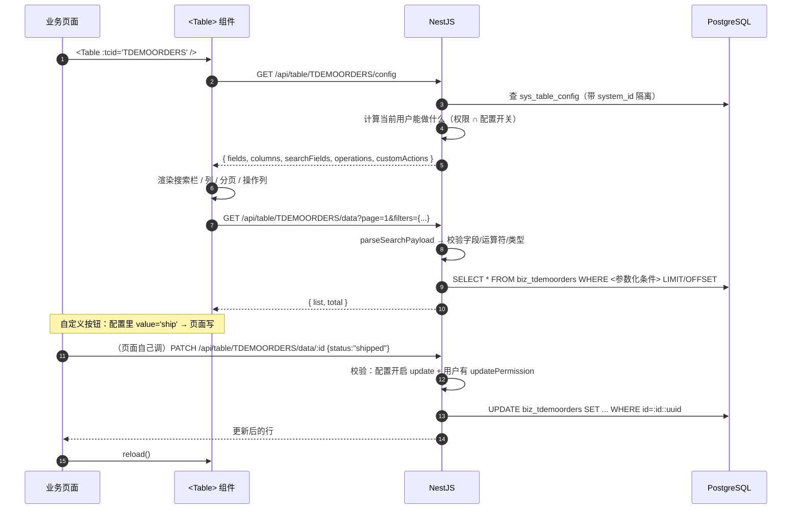
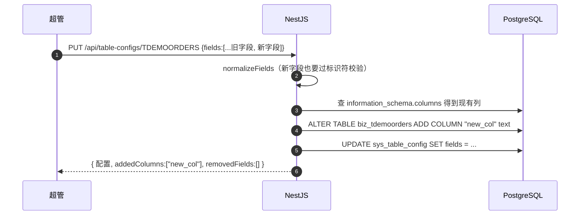

# 03 关键流程

> 图用 Mermaid 写在 markdown 里。下面 5 条是这套系统的主动脉，
> 看懂了这 5 张图，代码基本就懂了。

## 流程 1：超管登录

**注意**：账号不存在和密码错误返回同一句话「账号或密码错误」——防止被人试探哪些用户名存在。

## 流程 2：建子系统 → 切换上下文 → 配置

**关键**：`X-System-Code` 只有超管能生效；普通用户带上也会被 403。数据隔离靠这个值。

## 流程 3：配置一张表格 → 生成 TCID（含失败回滚）

**为什么要这个顺序**：先建表再写配置，并在写配置失败时 DROP 表——
避免留下「有配置没表」（页面能打开但查询报错）或「有表没配置」（孤儿表）的中间状态。

## 流程 4：前端渲染一张表格 + 增删改 + 自定义按钮

**两条重要边界**：

- 搜索条件里的字段必须「在配置里」且 `searchable: true`，否则 400（防止用隐藏字段做探测）
- 写操作是**双层校验**：表格配置开关 + 权限码，任一不满足都 403

## 流程 5：给已有表格加字段（ADD COLUMN）

**不会发生的事**：

- 已移除的字段：只从配置移除，物理列和数据保留（返回 `removedFields` 提示）
- 改字段类型：直接 400 拒绝（提示「请新建字段代替」）
